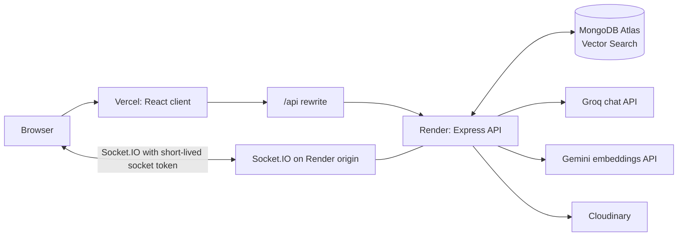
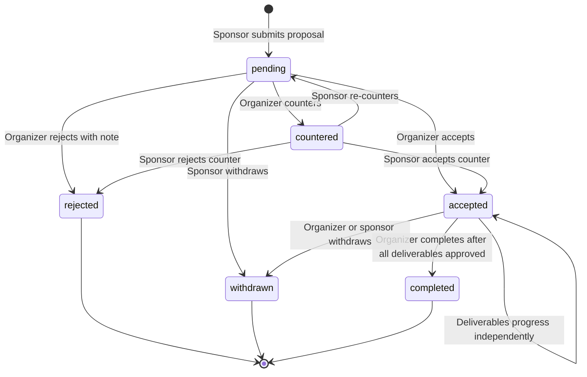

# Fynd

**A simpler way for small brands and event organizers to find and run sponsorships.**

> **Project links — fill in before sharing**
>
> - **Live app:** https://fynd-nu.vercel.app/
> - **API:** https://fynd-wbz6.onrender.com/api/health
> - **Demo video:** https://drive.google.com/file/d/1yHE1IdJ5i-tvvwCKu0MkLKuC8uUMl61l/view?usp=sharing

## Problem Statement

Small companies often struggle to find relevant, affordable events to sponsor. Event organizers, including student clubs and community groups, often rely on unstructured outreach to find sponsors and coordinate a deal.

## Target Users

- **Event organizers:** student festivals, campus clubs, community groups, sports clubs, and local event teams.
- **Sponsors:** small and mid-size businesses, startups, local brands, and other companies seeking event audiences.

## Solution

Fynd is a two-sided sponsorship marketplace. Organizers publish events with sponsorship tiers, while sponsors discover events, send proposals, and coordinate with organizers through a shared proposal workflow that includes negotiation, chat, and deliverable tracking.

### Deployment links

- **Live app:** https://fynd-nu.vercel.app
- **API:** https://fynd-wbz6.onrender.com/api/health
- **Demo video:** https://drive.google.com/file/d/1yHE1IdJ5i-tvvwCKu0MkLKuC8uUMl61l/view?usp=sharing
  
## Key Features

### Workflow 1: Onboarding

- Sign up and log in as an organizer or sponsor.
- Maintain role-specific profile information.
- Protected routes and role checks restrict actions to the appropriate account type.

### Workflow 2: Event publishing

- Organizers create, edit, publish, and manage events with sponsorship tiers and benefits.
- Upload event banners through Cloudinary when configured.
- Use AI event prefill from a pasted event description; organizers review and edit fields before saving.

### Workflow 3: Discovery

- Browse published events with text search, city, category, date, tier price, and footfall filters.
- Sponsors see up to five recommended events with a match score and reason when recommendations are available.

### Workflow 4: Deal flow

- Sponsors send proposals for event tiers.
- Organizers accept, reject, or counter proposals; sponsors can respond to counter-offers or withdraw.
- Participants can review proposal status history and chat in a proposal-specific thread.
- Notifications are shown in the app and polled by the client.

### Workflow 5: Delivery tracking

- Accepted proposals create deliverables from the selected tier's benefits.
- Organizers can mark deliverables as delivered with a note or proof file.
- Sponsors can approve or dispute delivered items; organizers can re-deliver disputed items.
- Organizers can complete a proposal after all its deliverables are approved.

### AI features

- **Proposal drafter:** creates an editable sponsorship message for the sponsor to review before sending.
- **Semantic matching:** creates event and sponsor embeddings, ranks relevant published events, and provides a generated or templated reason.
- **Event prefill:** extracts event information from pasted text to prefill the organizer's event form for review.

AI is optional at runtime. If the AI provider is unavailable, the core marketplace remains usable; matching can fall back to regular event candidates and templated reasons.

## Tech Stack

- **Frontend:** React, Vite, React Router, Tailwind CSS, Axios, Socket.IO client (JavaScript).
- **Backend:** Node.js 20, Express, Mongoose, Zod, JWT, bcryptjs, Socket.IO.
- **Database:** MongoDB Atlas, including Atlas Vector Search for semantic event matching.
- **AI:** Groq chat completions through the OpenAI-compatible client; Gemini REST API for embeddings.
- **File storage:** Cloudinary for event banners and deliverable proof files.
- **Deployment:** Vercel frontend, Render API, MongoDB Atlas database.
- **Testing:** Vitest and Supertest for the backend; no frontend test suite is configured.

## Architecture

The React SPA is deployed to Vercel. Its `/api` requests are rewritten to the Express API on Render, while Socket.IO connects directly to the Render origin. The API reads and writes application data in MongoDB Atlas, uses Atlas Vector Search for event candidates, calls Groq for chat generation and Gemini for embeddings, and stores uploaded media in Cloudinary.



### Proposal state machine



## Key Engineering Decisions

- **Atomic slot reservation:** accepting a proposal increments a tier's `slotsFilled` only when capacity remains, preventing concurrent acceptances from overselling the tier.
- **Single transition function:** proposal status changes go through `transitionProposal()`, which checks role, ownership, transition validity, history, notifications, slot counts, and deliverable creation.
- **Short-lived socket tokens:** the client obtains a 60-second socket-purpose JWT through the authenticated API and supplies it to Socket.IO, rather than relying on cross-origin cookie behavior in the socket handshake. The server verifies the token and checks proposal participation before joining a chat room.
- **Graceful AI degradation:** embedding work is fire-and-forget for publishing/profile updates. Match generation falls back when vector search fails and uses templated reasons if reason generation fails. AI errors do not prevent non-AI marketplace workflows.
- **REST-only message creation:** clients create messages through authenticated REST endpoints. Socket.IO broadcasts new messages to authorized proposal rooms; it does not accept client message-send events.
- **Validated AI output:** generated event extraction and match-reason JSON is validated with Zod before use. Proposal drafts are trimmed to the message limit.

## Local Setup

### Prerequisites

- Node.js 20 and npm.
- A MongoDB Atlas database or another MongoDB deployment accessible from the server.
- Optional: Groq and Gemini API keys for runtime AI features; Cloudinary credentials for uploads.

### Install and configure

```sh
git clone <repository-url> Fynd
cd Fynd

cd server
npm install
Copy-Item .env.example .env
```

Fill in the required server values in `server/.env`, at minimum `MONGO_URI` and `JWT_SECRET`. Set `CLIENT_URL` to the client origin. Copy and configure the client environment:

```sh
cd ..\client
npm install
Copy-Item .env.example .env
```

For local development, set `VITE_API_URL` to the local API base and `VITE_SOCKET_URL` to the local server origin. The example file uses these local defaults.

### Run the application

In one terminal:

```sh
cd server
npm run dev
```

In another terminal:

```sh
cd client
npm run dev
```

Vite prints the local client URL when ready. The backend listens on the configured `PORT`.

### Run backend tests

```sh
cd server
npm test
```

The test suites connect to the `fynd_test` database name and exercise the API with Vitest and Supertest.

### Seed demo data

From `server`, run:

```sh
npm run seed
```

The seed script deletes and recreates only records linked to users whose email ends in `@demo.fynd`. It creates demo users, events, proposals, deliverables, messages, and notifications. It does not remove unrelated database records.

To attempt embeddings during seeding, set `SEED_EMBEDDINGS=true` in the server environment before running the command. Embedding failures are reported without preventing the rest of the seed operation.

To generate embeddings later for published events and sponsors that do not yet have one:

```sh
npm run backfill-embeddings
```

Both operations require a reachable configured database. Embedding generation additionally requires a valid Gemini API key.

### Atlas Vector Search index setup

In the Atlas UI, create a **Vector Search** index on the `events` collection, named `event_embedding_index`. Use this JSON definition:

```json
{
  "fields": [
    {
      "type": "vector",
      "path": "embedding",
      "numDimensions": 768,
      "similarity": "cosine"
    },
    {
      "type": "filter",
      "path": "status"
    },
    {
      "type": "filter",
      "path": "endDate"
    }
  ]
}
```

The index name, embedding field, dimensions, similarity, and filter fields must match the vector search in the server.

## Environment Variables

Do not commit `.env` files or place real credentials in this table. Start from `server/.env.example` and `client/.env.example`.

### Server

| Variable | Description |
|---|---|
| `PORT` | Port used by the Express/Socket.IO server. |
| `NODE_ENV` | Runtime environment: development, test, or production. |
| `MONGO_URI` | MongoDB connection URI. |
| `JWT_SECRET` | Secret used to sign and verify authentication and socket tokens. |
| `CLIENT_URL` | Allowed client origin for CORS. |
| `GROQ_API_KEY` | Optional credential for Groq chat generation. |
| `GROQ_BASE_URL` | Optional OpenAI-compatible chat API base URL. |
| `LLM_MODEL` | Primary chat model identifier. |
| `LLM_FALLBACK_MODEL` | Fallback chat model identifier. |
| `GEMINI_API_KEY` | Optional credential for Gemini embedding requests. |
| `EMBEDDING_MODEL` | Gemini embedding model identifier; defaults to `gemini-embedding-001`. |
| `EMBEDDING_DIMENSIONS` | Embedding dimensionality; defaults to `768`. |
| `CLOUDINARY_CLOUD_NAME` | Optional Cloudinary account name for media uploads. |
| `CLOUDINARY_API_KEY` | Optional Cloudinary API key. |
| `CLOUDINARY_API_SECRET` | Optional Cloudinary API secret. |
| `SEED_EMBEDDINGS` | Optional seed-script switch; set to `true` to attempt embeddings during seeding. |

### Client

| Variable | Description |
|---|---|
| `VITE_API_URL` | API base URL. Use the local server URL in development and `/api` when using the Vercel rewrite in production. |
| `VITE_SOCKET_URL` | Socket.IO server origin; in production this is the Render API origin. |

## Deployment

### Render API

- Create a Node web service with the repository's `server` directory as its root.
- Install dependencies from `server/package.json`; use `npm start` as the start command.
- Configure the required server environment variables in Render. Set `NODE_ENV` to production and `CLIENT_URL` to the deployed Vercel origin. Configure the MongoDB, JWT, and provider credentials in Render's environment settings.
- Render supplies the port through `PORT`; the server reads it from the environment.
- Keep the API reachable over HTTPS for the Vercel client and Socket.IO.

### Vercel client

- Create a Vercel project with `client` as its root directory.
- Use `npm run build` as the build command and `dist` as the output directory.
- Set `VITE_API_URL` to `/api` and `VITE_SOCKET_URL` to the HTTPS origin of the Render service.
- The checked-in `client/vercel.json` rewrites `/api/:path*` to `https://fynd-wbz6.onrender.com/api/:path*` and sends other paths to `/index.html` for client-side routing. If the API is deployed at another Render URL, update the rewrite destination to that API origin. The rewrite keeps browser API requests same-origin with the Vercel app, while Socket.IO connects directly to Render.


## Demo Credentials

The seed script creates these accounts with the same demo password:

| Role | Email | Password |
|---|---|---|
| Organizer | `organizer1@demo.fynd` | `Demo@1234` |
| Sponsor | `sponsor1@demo.fynd` | `Demo@1234` |

These are demo-only credentials. Do not reuse the password for a real account.

## Testing

The backend tests use Vitest and Supertest. Coverage includes:

- Signup, login, authentication, and role restrictions.
- Event creation, publishing, visibility, filtering, pagination, ownership, and banner upload validation.
- Proposal creation, valid and invalid transitions, transition history, notifications, slot capacity under concurrent acceptance, and participant access.
- Chat participation, validation, message ordering, notifications, socket authentication, room joining, and message broadcasts.
- Deliverable role permissions, state changes, proof validation, notifications, and proposal completion prerequisites.
- AI endpoint authorization and validation, mocked model behavior, embedding-related matching scores, fallback candidates, and graceful failure behavior.
- Health and standard not-found responses.

Run all backend tests with `npm test` from the `server` directory. No frontend test suite is configured.

## AI Usage

AI coding tools were used during development. At runtime, Fynd uses Groq for chat generation and Gemini for text embeddings. AI output is validated where structured data is expected, and the application is designed to keep core marketplace actions available when AI services are unavailable.

## Known Limitations

- Free-tier Render services can have cold starts of up to a minute.
- Groq and Gemini free-tier rate limits and availability can change.
- Cloudinary PDF delivery depends on the Cloudinary account's resource and delivery settings.
- Notifications are in-app only; there are no email notifications.
- Semantic matching requires a correctly configured Atlas Vector Search index. If vector search is unavailable, the API falls back to regular event candidates.
